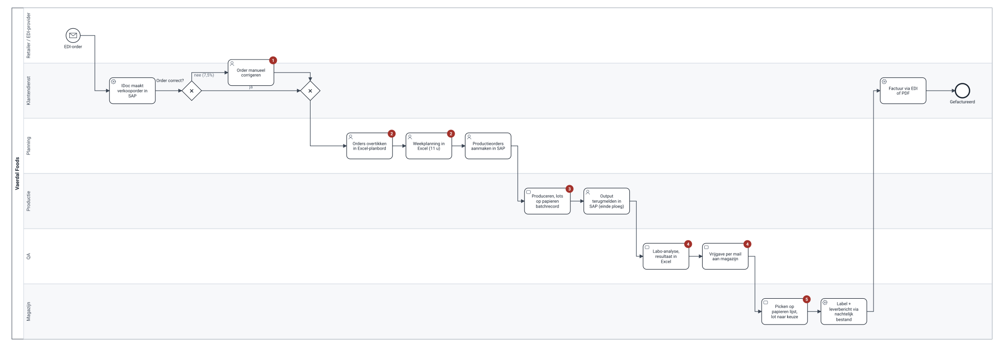
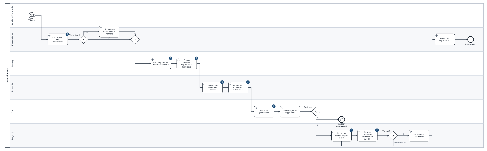

# Order tot levering: as-is → to-be

> **Wat dit is:** het kernproces van Vaerdal, vandaag en in Business Central, met wat er verandert en waarom. **Voor wie:** proceseigenaars, key users, partner. **Terug naar:** [processen](README.md) · **Volgende:** [recall](recall.md).

**Eigenaar:** COO (productie en planning), teamleider klantendienst (order en levering), QA-manager (vrijgave). **Trigger:** EDI-order van een retailer. **Resultaat:** levering binnen de afgesproken houdbaarheid, factuur via Peppol of EDI.

## As-is

Bron: [asis-order-to-delivery.bpmn](bpmn/asis-order-to-delivery.bpmn)

| # | Pijnpunt | Gevolg |
|---|---|---|
| 1 | 7,5% van de EDI-orders wordt manueel gecorrigeerd (eenheid, prijs, artikelcode) | een halve fte bij klantendienst, fouten bij piekdagen |
| 2 | De planner tikt orders over in een Excel-planbord; MRP in SAP wordt niet gebruikt | 11 uur per week plannen; één persoon kent de formules |
| 3 | De lotkoppeling grondstof → eindproduct staat alleen op papier | recall-oefening 3u40 |
| 4 | QA-vrijgave via Excel en mail | het systeem weet niet of een lot vrij is; een niet-vrijgegeven lot kan vertrekken |
| 5 | Picken op een papieren lijst, lot naar keuze | geen FEFO, geen controle op de resterende houdbaarheid per retailer: retours en boetes |

## To-be

Bron: [tobe-order-to-delivery.bpmn](bpmn/tobe-order-to-delivery.bpmn)

| | Wat verandert | Waarom | Eis | Test |
|---|---|---|---|---|
| A | De EDI-connector maakt de verkooporder; alleen uitzonderingen komen in een werklijst | mensen behandelen afwijkingen, niet elke order | VK-01, VK-04, VK-06 | UAT-01 |
| B | Het planningsvoorstel berekent de behoefte; de planner controleert de capaciteit per lijn in Power BI en keurt goed | de planner beslist, het systeem rekent | PR-03, AK-01 | UAT-02 |
| C | Grondstoflots worden gescand bij verbruik; output krijgt automatisch lot en vervaldatum | de genealogie ontstaat terwijl er gewerkt wordt | PR-05, PR-06 | UAT-05 |
| D | Elk nieuw lot is geblokkeerd tot QA het vrijgeeft | een niet-vrijgegeven lot kan niet gepickt worden | KW-01 | UAT-05 |
| E | Picken met scanner volgens FEFO, met controle op de minimale resterende houdbaarheid per klant | geen retours meer door te korte houdbaarheid | KW-04, VK-05 | UAT-04 |

## Uitzonderingen die in het model zitten

- **Order niet valide** (onbekend artikel, prijsafwijking, kredietlimiet): naar de werklijst van klantendienst, niet stil in een wachtrij.
- **Lot niet conform:** blijft geblokkeerd; QA beslist over herbewerking of vernietiging buiten dit proces.
- **Lot voldoet niet aan de resterende houdbaarheid van de klant:** de scanner weigert en vraagt een ander lot. Is er geen ander lot, dan meldt het magazijn het aan klantendienst (deelbelevering of vervanging).

## Wat bewust níet veranderde

- Het **papieren batchrecord** met CCP-registraties blijft in fase 1 (PR-08). Het lotnummer komt nu uit Business Central, zodat papier en systeem aansluiten.
- De **controleweegschalen** blijven los; de operator boekt de output (ADR-007).
- **Labo-resultaten** blijven in de Excel van QA; de vrijgave zelf gebeurt wel in Business Central (KW-05 naar fase 2).

## Waarom zo gemodelleerd

Eén pool (Vaerdal) met lanes per rol, en de retailer als lane in plaats van een aparte pool: voor deze lezers (proceseigenaars en key users) is "wie doet wat" belangrijker dan berichtuitwisseling tussen organisaties. De EDI-berichten zelf staan in de [fit-gap](../04-fit-gap/fit-gap.md) (VK-01 tot VK-03).
