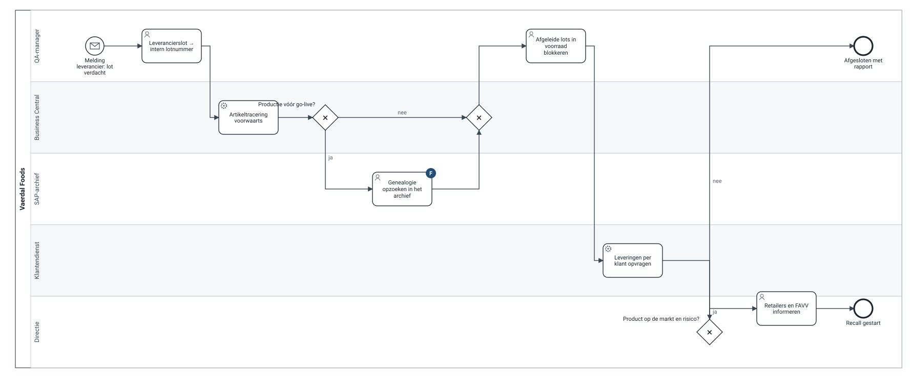

# Recall van een grondstoflot

> **Wat dit is:** het proces dat moet werken op dag één na de go-live, ook voor lots die in SAP gemaakt zijn. **Voor wie:** QA-manager, directie, auditor. **Terug naar:** [processen](README.md).

**Eigenaar:** QA-manager. **Trigger:** een leverancier, een klant of een eigen controle meldt een probleem met een lot. **Doel:** binnen een uur weten welke lots in voorraad geblokkeerd moeten worden en welke klanten welke lots ontvingen.

Bron: [tobe-mock-recall.bpmn](bpmn/tobe-mock-recall.bpmn)

## Waarom dit proces de go-live bepaalde

Een voedingsbedrijf moet voor elk product weten van wie het kwam en aan wie het ging, en het moet kunnen terugroepen ([Verordening (EG) 178/2002, art. 18–19](https://eur-lex.europa.eu/legal-content/NL/TXT/?uri=CELEX:32002R0178)). Certificeringsstandaarden vragen daarbovenop een geteste traceeroefening binnen een vaste tijd. Na een ERP-wissel is het risico niet dat Business Central niet kan traceren, maar dat de **brug tussen oud en nieuw** breekt: een lot in voorraad op de dag van de go-live, gemaakt in SAP uit grondstoffen van een leverancier, moet in beide richtingen te volgen blijven.

Drie ontwerpkeuzes zorgen daarvoor:

1. **Lotnummers blijven ongewijzigd** ([ADR-008](../adr/adr-008-lotnummers-behouden.md)). Het lotnummer op het etiket in het koelhuis, in Business Central en in het SAP-archief is hetzelfde.
2. **De SAP-genealogie blijft raadpleegbaar** in het archief, niet gemigreerd ([ADR-003](../adr/adr-003-geen-historiek-wel-archief.md)).
3. **Elk lot in voorraad gaat mee met een vervaldatum.** Zonder vervaldatum geen FEFO, geen controle op resterende houdbaarheid en geen volledige recall (regel DQ-10).

## De mock recall als test

Bij elke proefmigratie draait dezelfde oefening op de gemigreerde data ([`erpcase/transform.py`](../../erpcase/transform.py), `mock_recall`): voor de 25 grondstoflots met de meeste afgeleide lots in voorraad (het slechtste geval) volgen we de genealogie voorwaarts en tellen we hoeveel afgeleide lots in Business Central terug te vinden zijn **met** lotnummer en vervaldatum.

| Proefmigratie | Afgeleide lots in voorraad | Terug te vinden | Volledigheid |
|---|---:|---:|---:|
| 1 | <!--n:mock1.recallDerived-->1.054<!--/n--> | <!--n:mock1.recallFound-->806<!--/n--> | <!--n:mock1.recall-->76,5%<!--/n--> |
| 2 | <!--n:mock2.recallDerived-->1.061<!--/n--> | <!--n:mock2.recallFound-->1.011<!--/n--> | <!--n:mock2.recall-->95,3%<!--/n--> |
| 3 (generale repetitie) | <!--n:mock3.recallDerived-->1.077<!--/n--> | <!--n:mock3.recallFound-->1.041<!--/n--> | <!--n:mock3.recall-->96,7%<!--/n--> |
| 4 | <!--n:mock4.recallDerived-->1.124<!--/n--> | <!--n:mock4.recallFound-->1.124<!--/n--> | <!--n:mock4.recall-->100,0%<!--/n--> |

<!--n:mock3.recall-->96,7%<!--/n--> klinkt goed. Het betekent dat bij een echte recall <!--n:mock3.recallMissing-->36<!--/n--> lots halffabricaat, fysiek in de hal, niet in het systeem zouden staan. Daarom is het criterium 100% en niet "hoog genoeg" ([go/no-go](../08-go-live/go-no-go.md)).

## De oefening door QA (UAT-15)

Naast de geautomatiseerde telling doet de QA-manager de oefening zelf, met een stopwatch: één grondstoflot voorwaarts tot de klanten, één eindproductlot achterwaarts tot de leveranciers. Na de go-live: elk kwartaal, als KPI ([batenreview](../09-baten/README.md)).
